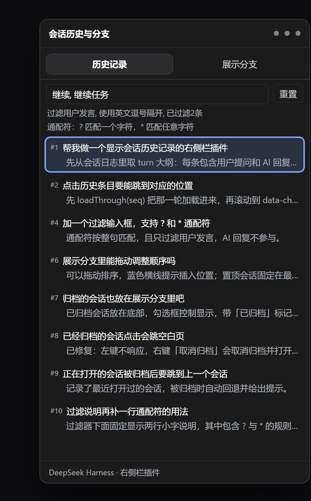

# 会话历史与分支（dsh-session-history-ui）

在 DeepSeek Harness 右侧栏里查看当前会话的聊天记录、一键跳转，并浏览所有会话之间的分支关系。

## 截图

| 历史记录 | 展示分支 |
| --- | --- |
|  |  |

> 截图使用示例会话数据渲染（面板与线上一致），不包含任何真实聊天内容。

## 功能

- **历史记录**：按轮次列出当前会话的用户消息与 AI 回复摘要。点击任意一条，会话窗口会跳到对应位置，并让该轮的用户提示词贴着聊天区顶部（距顶部 16px）；如果该轮次尚未加载，会先通过 `session.loadThrough(seq)` 把历史翻到目标轮次，再滚动定位。定位后用户提示词气泡会闪一下 0.5 秒的淡蓝光晕，提示「就是这里」。聊天区有「跟随底部」策略：当视图贴着最新消息时，任何内容或布局变化都会把它重新拉回底部，一次性的 scrollTop 写入会被悄悄撤销，这是「点了没反应、手动滑一下才跳过去」的根因。插件的做法是：先向聊天区派发一个合成的 `wheel` 事件（与真实滚轮走同一条 intent 通道）解除跟随底部，再写入位置；落位后继续监听滚动事件，只要目标行又漂走就再放回去（覆盖流式输出、历史分页这些会重新钉底的情况），并保持约 4 秒。这期间如果你自己滚动、触摸或按键，守卫立即停止，把位置交还给你。如果 12 秒内这一轮的 DOM 仍未出现，会弹出一条「聊天窗口还没加载到这一轮」的提示，避免点了没反应。
- **当前轮次高亮**：主聊天窗口滚动到哪一轮，历史记录里对应的那一条就会出现 2px 蓝色描边和淡蓝色底，方便知道自己现在看的是哪段对话。判定方式是读取聊天 DOM 里可见的 `[data-chat-turn]` 行（以 `[data-conversation-scroll]` 的视口为准），滚动时按帧节流更新。描边颜色取主题的 `--dsw-alias-state-business-primary`（DSH 暗色主题里的品牌蓝），而不是 `--dsw-alias-brand-primary`（它在暗色主题下是接近黑色的文字反色）。
- **Ctrl+F 查找**：按 `Ctrl+F`（macOS 为 `⌘F`）会打开右侧栏的「会话历史」并弹出类似浏览器查找栏的检索框：输入关键词后实时显示 `当前/总数`，`↑`/`↓` 切换上下一个匹配（`Enter` 下一个、`Shift+Enter` 上一个），`Esc` 或 `×` 关闭；每次切换匹配会同时把主聊天窗口滚到那一轮。检索框下方有三个范围按钮：**全局**（用户发言 + AI 回复）、**AI**（只搜 AI 回复）、**人类**（只搜用户发言）。命中的文字会在列表里用高亮标出；查找期间会临时显示被过滤器隐藏的轮次，避免搜不到。
- **过滤用户发言**：历史记录上方有一个过滤器输入框。默认过滤 `继续`、`继续任务` 这类任务中断后的接续记录；支持多个条件（用逗号或换行分隔），并支持通配符 `?`（匹配一个字符）与 `*`（匹配任意字符）。过滤只匹配用户的发言，不会因为 AI 回复命中条件而隐藏记录。过滤条件保存在 `localStorage` 的 `dsh.session-history.filters.v1`。输入框下方用小字提示 ``过滤用户发言, 使用英文逗号隔开, 已过滤x条``（x 为当前被过滤掉的条数）与通配符说明。提示行下面还有「过滤重复」和「过滤定时任务」两个勾选框。
- **历史记录默认定位到最新**：打开「历史记录」时列表默认滚动到最下面（最新一轮）；如果你手动往上翻，它不会把你拽回来，滚回底部后又会自动跟随新记录。
- **轮次右键菜单**：在「历史记录」里的任意一轮上右键，会弹出轮次操作菜单：**在此轮之前分支**（以该轮之前的日志状态新建分支，用来重做这一轮）、**本轮分支**（分叉点在该轮之后，从这一轮继续）、**复制**（整轮 / 用户提示词 / AI 回复，复制的是从会话日志里读出的完整原文，而不是列表里的 50/120 字摘要）、**隐藏这一轮**（把该轮的用户提示词追加到过滤条件，立即从列表消失）。分支操作会在新会话创建后自动切换过去，失败会提示。菜单项会按当前轮次计算可用状态：第一轮不能「在此之前分支」，没有文本时不能复制或隐藏。
- **过滤重复**：过滤提示行下方有「过滤重复」勾选框。勾选后，用户提示词完全相同的轮次只保留最后一轮（比较时忽略首尾空白和连续空白），前面重复的轮次会被隐藏，「已过滤 x 条」会把重复隐藏的数量一起算进去。勾选状态保存在 `localStorage` 的 `dsh.session-history.dedupe.v1`。
- **过滤定时任务**：「过滤重复」右边的勾选框。定时任务（schedule 提醒、自动化批次）在日志里是以 source.kind = schedule 的用户消息注入的，列表里原本会显示成「（无文本）」。勾选后这些自动化轮次会被隐藏；它的状态保存在 `localStorage` 的 `dsh.session-history.hideScheduled.v1`。
- **自动化任务标记**：插件会读取该轮的事件窗口，识别出非人工注入的轮次，并把列表里的「（无文本）」替换成「**自动化任务 HH:mm**」（时间取这一轮第一个事件的本地时间），这样一眼就能分清哪些轮次是定时任务跑出来的。
- **当前会话被归档时切回上一个会话**：插件会记住最近打开过的会话顺序。如果正在打开的会话被归档（DSH 会清空主视图、留下空白页），插件会自动打开上一个仍然存在且未归档的会话，并提示「当前会话已归档，已自动切换到上一个会话」。
- **展示分支**：把当前所有会话（不含子代理会话）以「分支树」的形式列出来：普通会话是根，用「在新对话中分支」产生的会话作为子节点，并在前面用 `├─` / `└─` / `│` 这类树形连接符画出来（像大写 L 一样的拐角，多层嵌套时逐级缩进），同时标注「分支自 …」。点击任意会话可以直接切换过去；在会话上右键会打开与会话列表一致的会话右键菜单（重命名、分叉、复制 Session ID、归档等，由各插件贡献的菜单项也会出现）。未命名（Host 只能显示成工作区目录名或原始会话 ID）的会话不会出现在这里；已归档的会话默认隐藏，见下一条。
- **已归档会话**：分支树最下面有一条横线，横线上有「展示已归档的会话」勾选框，勾选后会在横线下方按最近更新顺序列出已归档的会话，标题置灰并带「已归档」标记。左键点击已归档会话不做任何操作（DSH 会主动关闭已归档会话的主视图，直接跳转只会得到空白页面）；在归档行上右键选择「取消归档」后，插件会在取消归档落地后自动打开该会话，并弹出「已取消归档并打开会话」提示。勾选状态保存在 `localStorage` 的 `dsh.session-history.showArchived.v1`。
- **面板内置顶**：在「展示分支」里右键会话选择「置顶会话」，只会把会话置顶在这个面板里（置顶的会话排在列表最上面，并显示「置顶」标记），不会影响左侧工作区列表的置顶；选中「取消置顶」即可恢复。置顶记录保存在 `localStorage` 的 `dsh.session-history.pinned.v1`。
- **拖动调整顺序**：「展示分支」里的会话可以直接拖动排序，顺序保存在 `localStorage` 的 `dsh.session-history.order.v1`；置顶的会话始终固定在最上面，不能和非置顶会话互相拖动。拖动经过某一行时，会像左侧工作区一样在行的上沿或下沿显示一条蓝色横线，表示松手后的插入位置。
- **运行 / 完成提醒**：与左侧工作区一致，正在思考 / 输出的会话前面显示同样的转圈圈（旋转的圆环 + 呼吸的圆弧），AI 输出完成但还没查看的会话显示绿色圆点并把标题显示为黄色，提醒你这条会话有新的完成结果。转圈圈只在会话真正运行时出现，排队、空闲或仅等待输入都不会显示。
- **自动记录分支**：在任意会话（主会话或分支会话）中点击「在新对话中分支」时，插件会记录父子关系（`childId`、`parentId`、分叉点 `atSeq`、时间）。记录保存在 `localStorage` 的 `dsh.session-history.branches.v1`。
- **删除同步**：会话被删除后，它会从「展示分支」列表中消失；对应的分支记录也会在会话列表就绪后被自动清理。
- **历史分支推断**：插件安装前产生的分支，DSH 普通分支并不会持久化父会话（`parentSession` 只写给子代理会话），所以没有可直接复用的记录。插件会做两种尽力而为的还原：优先使用 Host 仍在返回的 `parentSessionId`；否则如果会话标题符合 DSH 的分支命名 `<父标题> (n)`，就把它挂到标题为父标题的现存会话下。推断出来的关系会标注「（推断）」，标题被改过或父会话已删除时可能推断不到。

## 使用

1. 打开任意会话的右侧栏（右上角的侧栏按钮），在工具页签里找到「会话历史」入口，点击打开。
2. 面板顶部有两个按钮：**历史记录** / **展示分支**，用于切换两种视图。
3. 在聊天窗口的某条 AI 消息上使用「在新对话中分支」，随后打开「展示分支」即可看到新的分支。

## 实现说明

- 纯客户端插件：`index.js` 是空的 Host 端（`export function apply() {}`），全部逻辑在 `client.js`。
- 通过 `ctx.sidebarRightTabs.register` + `ctx.slots.register({ name: 'sidebar.right.pane.tab' })` 注册右侧栏页签。
- 历史记录来自 Host 的 `turnOutline` 投影（由 `@deepseek-ai/dsh-session-turn-outline` 提供），无需在客户端折叠事件。
- 分支关系在客户端包装 `ctx.sessions.fork` 记录；DSH 的普通 fork 不持久化父会话信息，因此只能在这一层记录。
- 「展示分支」的置顶是面板本地状态：打开菜单时记录来源会话，随后临时屏蔽 `ctx.remoteAccess.source` 里 `workspace/pinSession`、`workspace/unpinSession` 两个端点的数据（让内置的「置顶会话」项不出现），并注册本插件的 `session.historyPin` 菜单项写入本地置顶；`ctx.workspaces.pinSession/unpinSession` 也做了同样的兜底重定向，左侧工作区不受影响。
- 历史分支推断在 `buildBranchRows` 里完成：没有本地分支记录的会话先看 `summary.parentSessionId`（Host 有时仍会返回），再按标题正则 `/^(.+?)\s*[\(（]\d+[\)）]$/` 推导父标题并匹配现存会话；推断的父子关系在下钻时带环检测，根节点顺序仍按置顶/拖拽顺序/`updatedAt` 排序。
- 已归档会话的左键点击被忽略：ui-workspace 的 `watchNavigation` 在 `archivedSessionIds` 包含当前主视图会话时会 `clearMain()`，直接打开只会得到空白主视图。右键本面板的归档行会留下一个「待打开意图」（10 秒有效）；插件订阅 `ctx.workspaces.list`，一旦该会话从 `archivedSessionIds` 中消失（说明共享菜单里的「取消归档」动作已生效），就 `ctx.uiWorkspace.openSession(sessionId)` 并提示成功。这样不依赖拦截 ui-workspace 的服务调用，任何取消归档路径都能兜住。注意共享菜单会在执行菜单项之前先把 `contextMenus.active` 置空，因此面板标记采用「到期时间」而不是「active 变 null 立即清除」。
- 已归档会话走单独的 `buildArchivedRows`：只取存在于 `ctx.workspaces.list` 的 `archivedSessionIds` 里、且有真实标题的非子代理会话，按 `updatedAt` 倒序平铺在分支树下方；归档行不参与置顶、拖拽和分支树父子关系。
- 拖动顺序通过 HTML5 拖拽实现，落位后把当前展示顺序写回 `dsh.session-history.order.v1`；拖动时的蓝色插入线用 `::before` / `::after` 绘制，颜色取主题变量 `--dsw-alias-state-business-primary`，按指针落在行的上半/下半决定插入在目标行之前还是之后。
- 分支树的树形连接符在 `buildBranchRows` 的深度优先遍历里生成：每个节点把自己的「是否还有后续兄弟」压栈，子节点据此拼出 `│  ` 前缀，再用 `├─ ` / `└─ ` 收尾；根节点自身不画连接符（避免顶层出现悬空的竖线），父级提示行按连接符宽度用等宽空格对齐。连接符用等宽字体渲染，只占左侧一小列，不参与文本选择，也不会干扰拖拽。
- 运行 / 完成状态来自 `ctx.uiSession.sessionStatus`（`completionUnread` / `running`）：完成的标题使用 `--dsw-alias-state-warn-label`，完成圆点使用 `--dsw-alias-state-success-primary`。运行中的转圈圈由插件自己用 SVG + CSS keyframes 实现（14px，圆环 + 呼吸圆弧，颜色取 `--dsw-alias-label-tertiary`），刻意不引用 `@deepseek-ai/dsh-client-ui-primitives`（插件规范不允许），视觉与左侧工作区的 ongoing 状态一致；`prefers-reduced-motion` 下会停掉旋转，只保留静态圆弧。
- 「上一个会话」的兜底订阅了 `ctx.sessions.list`：从 `retainedBy.mainView` 读出当前主视图会话，维护最近 20 个主视图会话栈；当主视图会话被归档、主视图被清空时，从栈里取最近一个仍然存在且未归档的会话 `openSession` 打开。除了归档场景外不会触发，正常的会话切换不受影响。
- 历史记录的自动滚底用一个 ref 记录是否「贴底」（距离底部小于 24px），在投影轮次数、过滤条件或会话变化后，如果仍然贴底就把 `scrollTop` 设到 `scrollHeight`；用户主动上翻后不再自动跟随。
- 当前轮次高亮监听文档捕获阶段的 `scroll` 事件并对 `requestAnimationFrame` 节流，按 `[data-chat-turn]` 行相对滚动容器的位置挑出视口顶部那一轮；因此不需要 Chat 视图暴露额外 API。
- 点击跳转不直接调用 Chat 内部导航（`ChatNavigation` 未对外暴露）：插件自己计算 `[data-chat-turn]` 里该轮的「用户提示词行」相对 `[data-conversation-scroll]` 的位置并写入 16px 顶部间距。为了绕过 Chat 的「跟随底部」重钉，跳转前会在滚动容器上派发一个带标记的合成 `wheel` 事件，命中 Chat 的 reading-intent 监听（`READING_INTENTS`）后调用 `interruptFollow`；改完 scrollTop 后再监听 `scroll`，如果又被重钉就再次纠正。合成事件带 `__dshSessionHistorySynthetic` 标记，插件自己的接管监听会忽略它，避免把自己的程序滚动当成用户手势。
- 点击跳转的定位步骤：先找到该轮 `data-chat-flow-kind="user"` 的那一行（即人类提示词），用 `scrollTop = scrollTop + (rowTop - viewportTop) - 16` 直接赋值实现瞬时对齐（聊天区在隐藏/离屏时浏览器的平滑滚动会被丢弃，直接赋值更可靠），随后给这行里真正画出背景的气泡元素（优先 `[data-message-bubble]`，否则取行内背景色不透明、面积最大的后代）盖一个 0.5s 的蓝色光晕覆盖层（`position: fixed` 的 `.dsh-sh-flashLayer`，蓝色描边 + 外发光 + 渐隐）。用覆盖层而不是给气泡加 class，是因为聊天区是 React 树，外部加的 class 可能在下一次重渲染时被丢掉，用户根本来不及看到；覆盖层每帧用气泡的 `getBoundingClientRect()` 重新定位，并按聊天滚动容器的可视区域裁剪，所以滚动时会跟着气泡走，气泡滚出视口后就自动隐藏，不会悬空。覆盖层另有 0.7s 的兜底定时器（窗口隐藏时 `requestAnimationFrame` 可能被暂停），并且每次新的跳转都会让上一次的重新对齐定时器失效，避免连续点击时两个目标互相拉扯。
- 轮次右键菜单使用自定义的 target kind `sessionHistoryTurn`（`ctx.contextMenus.register({ id: 'session.historyTurn', target: 'sessionHistoryTurn', order: 10 })`），菜单值里带 `{ sessionId, turn, seq, nextSeq, prompt, response }`。分叉点 `atSeq` 必须是 Host 日志里已经存在的事件 seq：此前分支用 `seq - 1`，本轮分支用 `nextSeq - 1`，最后一轮省略（Host 回退到最近的完整前缀边界）；交给 `ctx.sessions.fork` 后插件已有的包装逻辑会记录父子关系。
- 「过滤重复」由 `dedupeTurns` 反向扫描实现：按规范化（trim + 合并连续空白）后的用户提示词保留最后一条，空提示词始终保留；「隐藏这一轮」把该轮用户提示词精确追加到过滤器并持久化，与手工输入的过滤条件共用同一套匹配逻辑。
- 复制完整原文走的是会话事件窗口：`ctx.sessions.binding(sessionId).eventSource` 给出当前已加载的事件；命中该轮 `turn/start` 后拼接 `user/message` 与 `assistant/message` 的文本块。如果这一轮还没加载（只有 `turnOutline` 的摘要），先 `binding.session.loadThrough(seq)` 补齐再重试；`turnOutline` 本身只有 50/120 字摘要，不能用来复制全文。
- 自动化轮次识别：`user/message` 的 `source.kind` 不是 user（定时任务为 schedule）即视为自动化；行标题时间取该轮第一个事件的 `time`（毫秒），用本地时区格式化成 `HH:mm`。
- Ctrl+F 快捷键在 `apply` 里通过 `ctx.effect` 注册文档捕获阶段 `keydown`（`ctrlKey || metaKey` + `f`），调用 `ctx.sidebarRight.openTab('session-history')` 打开页签，再通过一个模块级的 `finderHooks` 集合通知已挂载的面板打开检索框（页签可能刚打开，因此带最多 30 次、间隔 80ms 的重试）。检索范围只影响命中集合，不影响过滤器的保存值。

## 安装

从 npm 安装（推荐）：

```bash
dsh plugin add dsh-session-history-ui
```

或在 DSH 的「插件」页里选择「添加插件」，填入包名 `dsh-session-history-ui`、本仓库地址，或本地目录路径。安装后重启 / 刷新 DSH，右侧栏的「更多工具」里会出现「会话历史」入口。

## 开发

```bash
npm run check   # node --check client.js && node --check index.js
```

本地调试安装：在 DSH 的「插件」页里对本仓库目录使用插件安装流程（bundle patch 会以 `dsh-session-history-ui` 注入 `dsh-session-history`）。
